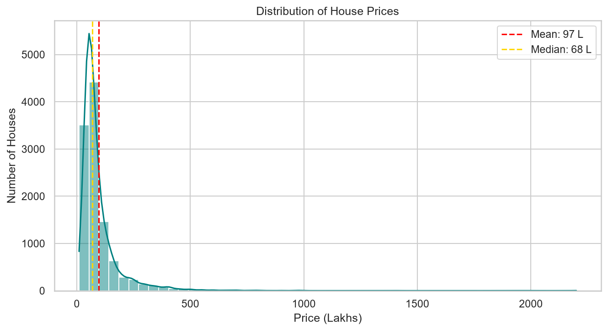
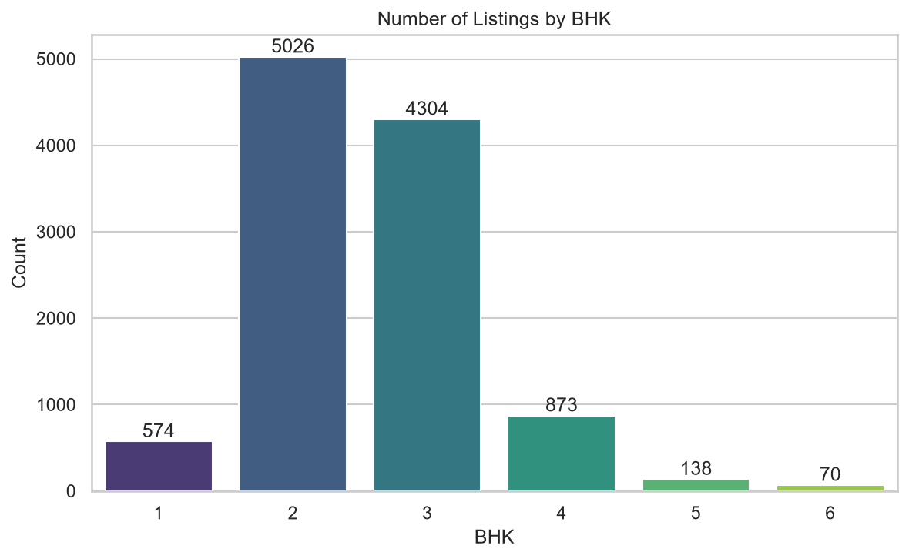
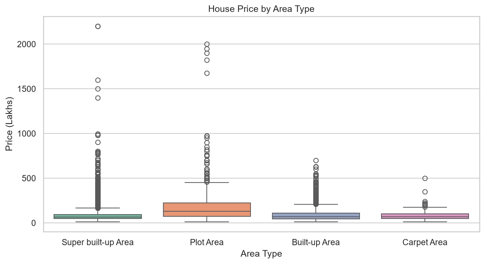
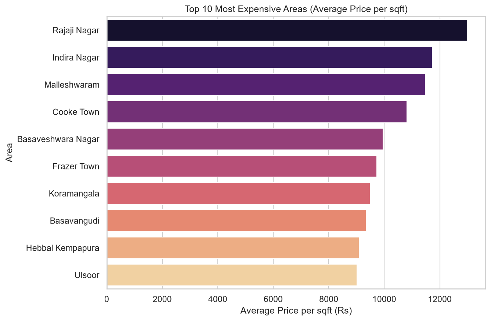
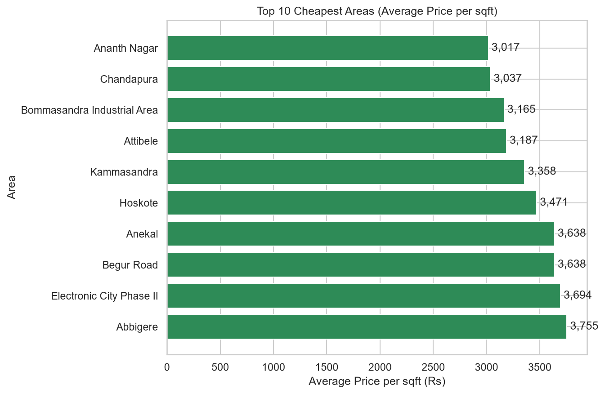
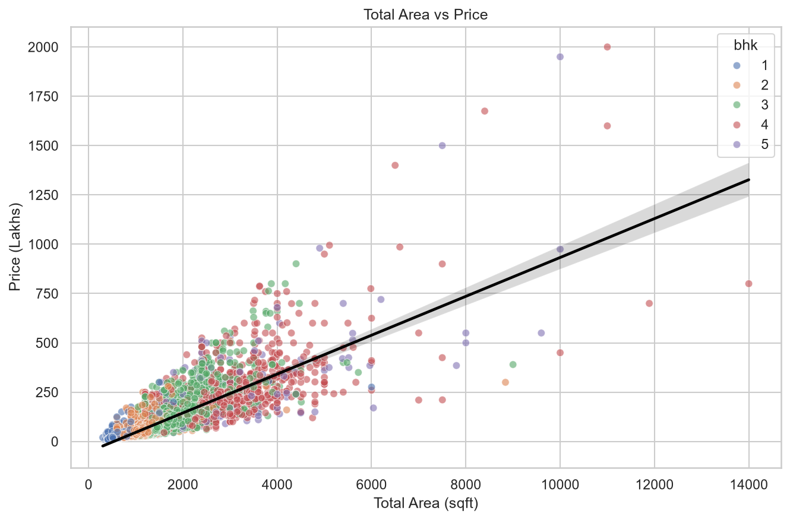
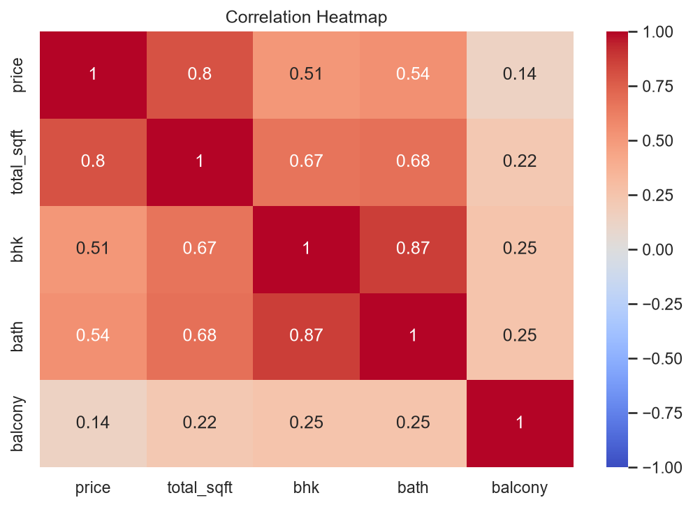
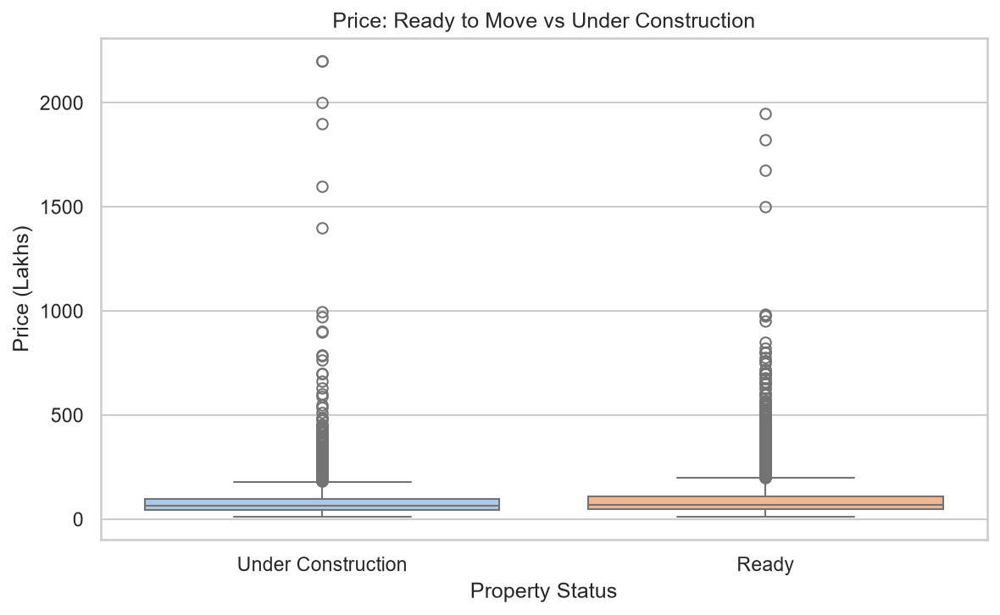
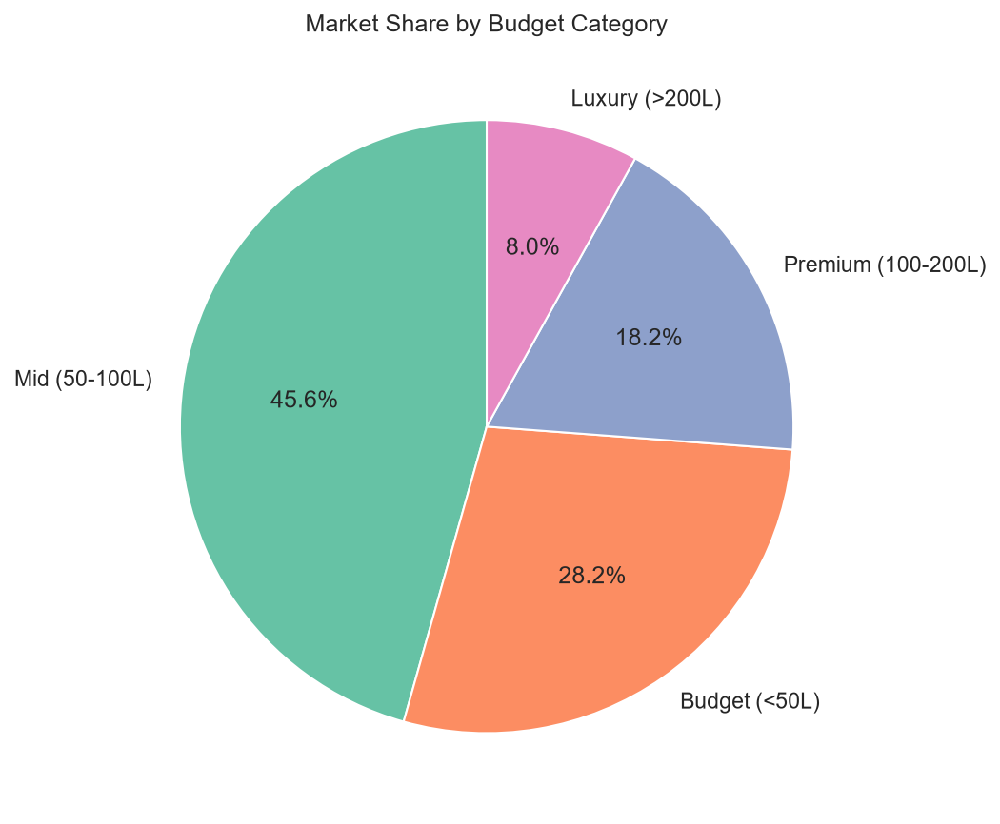

# 🏠 Bengaluru House Price Analysis

Exploratory data analysis of ~11,000 Bengaluru house listings to find out **what decides the price of a house**.
Built with **Python, Pandas, NumPy, Matplotlib and Seaborn**.

## Questions answered
1. Which areas are the most and least expensive?
2. Does a bigger house always cost more?
3. Does the area type (Plot, Super built-up, etc.) change the price?
4. Are ready-to-move houses costlier than under-construction ones?
5. How is the market divided between budget and luxury houses?

## Dataset
- Source: Bengaluru House Data (raw file: 13,320 rows, 9 columns)
- `Bengaluru_House_Data_Cleaned.csv`: cleaned version used in the notebook (11,055 rows)
- Price is in **lakhs** (1 lakh = 1,00,000 rupees)

## Data cleaning (done before analysis)
- Dropped `society` column (~41% missing) and removed 568 duplicate rows
- Handled missing values in `size`, `bath`, `balcony`
- Converted `size` ("2 BHK", "4 Bedroom") into a number column `bhk`
- Converted `total_sqft` ranges and different units into square feet
- Simplified `availability` into Ready / Under Construction
- Removed unrealistic rows and outliers
- Created new columns: `price_per_sqft`, `sqft_per_bhk`, `price_category`

## Key findings
1. **Location matters most.** Rajaji Nagar costs about ₹13,000/sqft while Ananth Nagar costs about ₹3,000/sqft (around 4x difference).
2. **Size is the strongest numeric factor.** Correlation of price with total sqft is 0.80 (bathrooms 0.54, BHK 0.51, balcony 0.14).
3. **2 and 3 BHK dominate** the market (about 84% of listings).
4. **Plot Area is the costliest** (median 130 lakh vs 65–70 lakh for other types).
5. **Ready vs under construction makes little difference** (median 69 vs 65 lakh).
6. **Mid-range heavy market:** 46% Mid, 28% Budget, 18% Premium, 8% Luxury. A few luxury homes push the mean (97L) above the median (68L).

## Charts

| | |
|---|---|
|  |  |
|  |  |
|  |  |
|  |  |
|  | |

## How to run
```bash
git clone <your-repo-link>
cd <repo-folder>
pip install -r requirements.txt
jupyter notebook Bengaluru_House_Price_Analysis_Simple.ipynb
```
Then click **Run All**.

## Project structure
```
├── Bengaluru_House_Price_Analysis_Simple.ipynb   # main notebook
├── Bengaluru_House_Data_Cleaned.csv              # cleaned dataset
├── images/                                       # saved charts
├── requirements.txt
├── .gitignore
└── README.md
```

## Limitations and future work
- No date column, so price trends over time cannot be studied.
- Location names may have spelling variations; prices are listing prices, not final sale prices.
- Future: price prediction with Linear Regression, and a map of Bengaluru areas.

## Author
Ankit Arya – imankitcoder / LinkedIn : www.linkedin.com/in/ankit-arya-0b58543a8/
